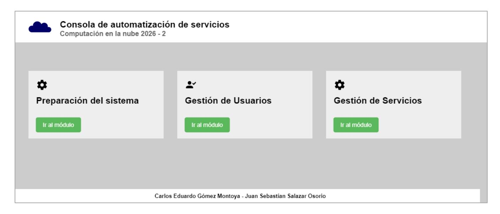
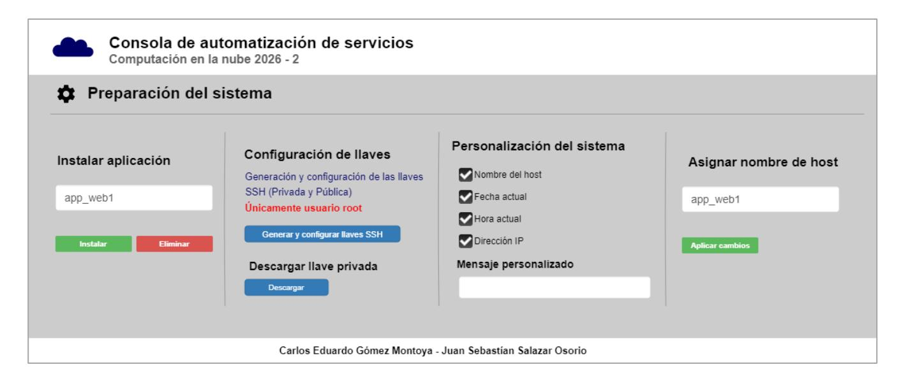
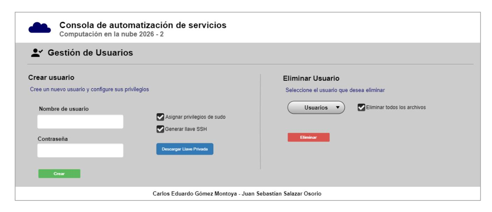
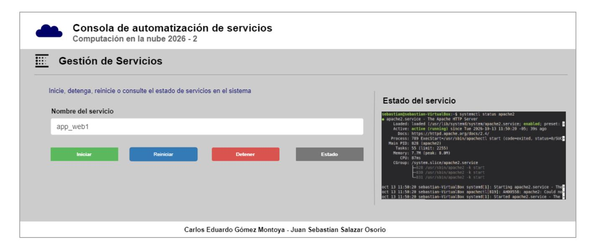

# **Nota Parcial #2 Servicios automatizados en una máquina virtual ejecutando GNU/Linux Debian**

### **1. CONTEXTO**

En actividades anteriores del curso de Computación en la Nube se han realizado de manera tradicional algunas de las tareas de administración de sistemas operativos GNU/Linux, tales como la instalación de paquetes, la configuración de SSH, la gestión de servicios (demonios) con systemd y el balanceo de carga. En este trabajo se propone convertir esas tareas en operaciones que puedan solicitarse desde una aplicación web desarrollada en Golang. La aplicación web va a funcionar como una consola de automatización para una máquina virtual, en este caso, ejecutando el sistema operativo Debian 13.7.0. El objetivo es integrar operaciones del sistema en una interfaz de usuario, validar las entradas, ejecutar acciones y reportar el resultado.

### **2. PRECONDICIONES Y ALCANCE**

Para este trabajo asumimos que cada grupo de trabajo dispone de:

- a) Una **máquina virtual** con las el sistema operativo GNU/Linux Debian 13.7.0, debidamente instalado y actualizado (apt update y apt upgrade), con el servidor **SSH** instalado y en ejecución como servicio, y con el adaptador de red configurado en modo puente. Esta máquina virtual será utilizada para las pruebas.
- b) Una **máquina virtual** con las configuraciones del punto a), junto con el servidor **HAPROXY** instalado y con su configuración predeterminada. Esta máquina virtual será utilizada en las pruebas de despliegue del balanceador de carga.
- c) Un **disco virtual** configurado como multiconexión con las configuraciones del punto a), junto con todo lo necesario para crear máquinas virtuales listas para ser utilizadas en el servicio de balanceo de carga. Este disco será utilizado para las pruebas de despliegue del balanceador de carga.
- d) El archivo ejecutable de la aplicación de catálogo de libros, junto con los demás archivos requeridos para la ejecución de la aplicación en Linux Debian. Este archivo será utilizado para las pruebas de gestión de servicios con systemd.
- e) Un script para ejecutar una aplicación que cada vez que se ejecuta, agrega al final del archivo un mensaje con la fecha y hora. Este archivo será utilizado para las pruebas de gestión de servicios con systemd.

#### **3. TRABAJO A REALIZAR**

Desarrolle una aplicación web en Golang que permita realizar, **de manera no interactiva**, las operaciones descritas en las secciones siguientes. La aplicación web debe organizar las funciones por módulos, mostrar formularios adecuados, validar los datos antes de ejecutar cada operación e informar si esta terminó correctamente. En caso de error, debe presentar un mensaje comprensible y conservar información técnica útil para el diagnóstico. Antes de instalar SSH, la comunicación con la máquina virtual se realizará a través de las Guest Additions. Luego de la instalación de SSH, la comunicación será exclusivamente a través de SSH, con llaves de autenticación. **Puede tomar como referencia los siguientes diseños de la aplicación.**

# **3.1 PREPARACIÓN DEL SISTEMA**

En este caso, vamos a incluir los siguientes cuatro servicios:

### **3.1.1 Instalación y eliminación de aplicaciones**

La aplicación web debe ofrecer un mecanismo para indicarle al sistema operativo que desea instalar o eliminar una aplicación. El usuario deberá completar un formulario para indicar la aplicación a instalar o a eliminar y al hacer clic en el botón correspondiente, la aplicación web deberá iniciar el proceso de instalación o eliminación de la aplicación en la máquina virtual. Al finalizar, notificar el resultado en la aplicación web.

#### **3.1.2 Configuración de la llave de acceso SSH para el usuario root**

La aplicación web deberá crear las llaves SSH para el usuario root, agregar la llave al archivo de llaves autorizadas y asegurarse de que no haya acceso a través de login y password. Al finalizar el proceso, la aplicación web deberá permitir la descarga de la llave privada para que el usuario root puede utilizarla cuando lo requiera. En la aplicación debe salir un mensaje recomendando el uso correcto de la llave privada.

#### **3.1.3 Personalización de la entrada del sistema al iniciar su ejecución**

La entrada al sistema se configura en el archivo **/etc/issue**. La aplicación web deberá contar con un mecanismo para establecer esta configuración, según lo desee el usuario. Debe incluir opciones para ver el nombre del host, la fecha, la hora, la dirección IP, entre otros, junto con algún mensaje personalizado para el inicio de sesión.

#### **3.1.4 Asignar el nombre de host y actualizar el archivo de hosts**

La aplicación web deberá tener un mecanismo para establecer el nombre de host del sistema operativo que se ejecuta en la máquina virtual y deberá actualizar el contenido del archivo **/etc/hosts** para que incluya el nuevo nombre de host.

### **3.2 GESTIÓN DE USUARIOS**

### **3.2.1 Crear usuarios y configurar privilegios de sudo al nuevo usuario**

La aplicación web deberá tener la capacidad de crear un usuario en el sistema. En la GUI debe tener una casilla de verificación para indicar que el nuevo usuario tendrá privilegios de **sudo**. También tendrá otra casilla de verificación para indicar que se debe generar un par de llaves criptográficas de autenticación, deberá instalar la llave pública y descargar la llave privada con las mismas condiciones de las llaves del usuario root del punto 3.1.2. Cuando habilite el acceso por SSH al nuevo usuario, deberá deshabilitar el acceso a través de login y password.

#### **3.2.2 Eliminar usuarios**

La aplicación web deberá tener la capacidad de eliminar un usuario en el sistema. Mediante una casilla de verificación se le debe indicar al sistema que, en el proceso de eliminar un usuario, también debe eliminar todos sus archivos.

# **3.3 GESTIÓN DE DEMONIOS CON systemd**

La aplicación web deberá permitir la configuración de una aplicación como servicio de systemd, por ejemplo, la aplicación web del catálogo de libros. Eso implica la transferencia de los archivos requeridos para su ejecución en una máquina virtual y la gestión de permisos. La GUI debe aportar los botones correspondientes a las acciones start, stop, restart, status, enable y disable sobre los servicios (o unidades) administrados. También puede probar con el script al que hace referencia el numeral e) en las precondiciones y alcance en el punto 2.

### **3.4 GESTIÓN DE UN BALANCEADOR DE CARGA CON HAPROXY**

La aplicación web deberá permitir tanto agregar un servidor al back-end del balanceador de carga como eliminarlo.

#### **4. PRUEBAS**

Diseñe y ejecute pruebas que permitan demostrar el funcionamiento de cada elemento de la solución desarrollada. Cada prueba realizada debe quedar grabada en video. En el video debe quedar claro el estado anterior del sistema antes de realizar el proceso automatizado y el estado posterior.

# **5. ESCENARIO DE APLICACIÓN**

Elabore un diagrama que represente el escenario utilizado para desarrollar y probar la solución. El diagrama debe mostrar como mínimo: equipo host; software de virtualización; máquinas virtuales; sistema operativo de cada máquina virtual; interfaces de red; direcciones IP; mecanismo utilizado para la comunicación entre host y máquina virtual; disco utilizado para almacenamiento; flujo general de la automatización. Acompañe el diagrama con una descripción breve del escenario.

### **6. DOCUMENTACIÓN**

Elabore un documento que contenga una descripción de la solución y las decisiones tomadas durante su desarrollo; el diseño de pruebas y los resultados obtenidos con las evidencias correspondientes; los principales problemas encontrados durante el desarrollo y la forma como fueron solucionados y las referencias bibliográficas y técnicas utilizadas durante el desarrollo, así como las herramientas de inteligencia artificial utilizadas, indicando para qué fueron utilizadas.

**Fecha de entrega:** Máximo el 26 de octubre de 2026, 11:59 pm.

**Sustentación:** A partir del 27 de octubre de 2026, 6:00 pm.

**Equipos de trabajo:** Mínimo 2 y máximo 3 estudiantes.

**Los equipos de trabajo serán registrados como respuesta a un mensaje en Classroom. Equipos de un (1) estudiante no serán autorizados.**